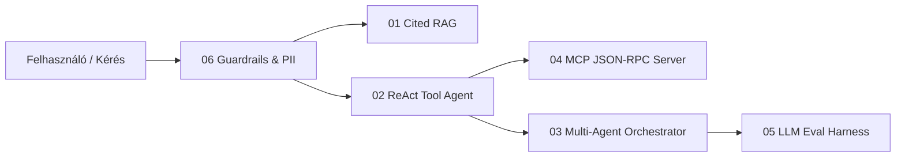

# AI Agent Patterns Lab — RAG, ReAct, Multi-Agent, MCP & Evals 🤖

**API-kulcs nélkül is azonnal futtatható, tesztelt produkciós AI-mérnöki minták Python 3-ban** — a [CuppaShot](https://cuppashot.hu) valós rendszereinek (Borostyán tudásgráf/MCP, Kaptár többágenses koordinátor, MAGMA SaaS) nyílt forráskódú architektúra-bemutatója.

*Zero-dependency, deterministic Python 3 reference implementations for production Agentic AI engineering: Cited RAG, ReAct Tool-Calling, Multi-Agent Orchestration, MCP JSON-RPC 2.0 Server, LLM Eval Harness, and PII/Prompt-Injection Guardrails.*



## Modulok (8 db)

| # | Modul | Leírás |
|---|---|---|
| `01` | **[Hivatkozásos RAG Motor (Chunking + Hybrid Retrieval + Citation Check)](./01-cited-rag-engine/)** | Dokumentumok darabolása átfedéssel, BM25-alapú keresés és forráshivatkozásos válaszgenerálás hallucináció-ellenőrzéssel. |
| `02` | **[ReAct Tool-Calling Ügynök-hurok (Safe Sandbox)](./02-react-tool-agent/)** | Eszköz-regiszter, lépéskorlát (`max_steps`), strukturált tool-meghívás és megfigyelhetőségi nyomkövetés (trace). |
| `03` | **[Többágenses Koordinátor (Planner → Builder → Reviewer)](./03-multi-agent-orchestrator/)** | Szereposztásos többágenses végrehajtási csővezeték automatikus felülvizsgálati körrel és újrapróbálással (Kaptár minta). |
| `04` | **[MCP (Model Context Protocol) JSON-RPC 2.0 Mini-szerver](./04-mcp-jsonrpc-server/)** | Szabványos MCP `initialize`, `tools/list` és `tools/call` kérések feldolgozása tiszta JSON-RPC 2.0 rétegen. |
| `05` | **[LLM Prompt-értékelő és Regressziós Tesztelő (Eval Harness)](./05-llm-eval-harness/)** | Automatikus prompt-minőségmérés arany tesztesetekkel (kötelező kulcsszavak, tiltott minták, max hossz, összesített pontszám). |
| `06` | **[AI Guardrails: PII-maszkoló & Prompt-Injection Szűrő](./06-ai-guardrails-pii/)** | Személyes adatok (e-mail, telefon, bankkártya) redaktálása LLM-hívás előtt és tipikus prompt-injection minták blokkolása. |
| `07` | **[Strukturált LLM Kimenet Parser & Repair Hurok](./07-structured-output-parser/)** | JSON kinyerés zajos LLM válaszból, séma-validáció és automatikus javító újrapróbálás. |
| `08` | **[SQLite Perzisztens AI-Ügynök Memória](./08-agent-memory-sqlite/)** | Munkamenet-izolált, fontosság-alapú epizodikus memória automatikus karbantartással (`prune`). |

## Összes teszt futtatása
```bash
python3 run_all_tests.py
```

🌐 Portfólió: [cuppashot.hu](https://cuppashot.hu) · 🚀 Fő termék: [magma-platform.hu](https://magma-platform.hu) · 👤 **Pék Richárd**
